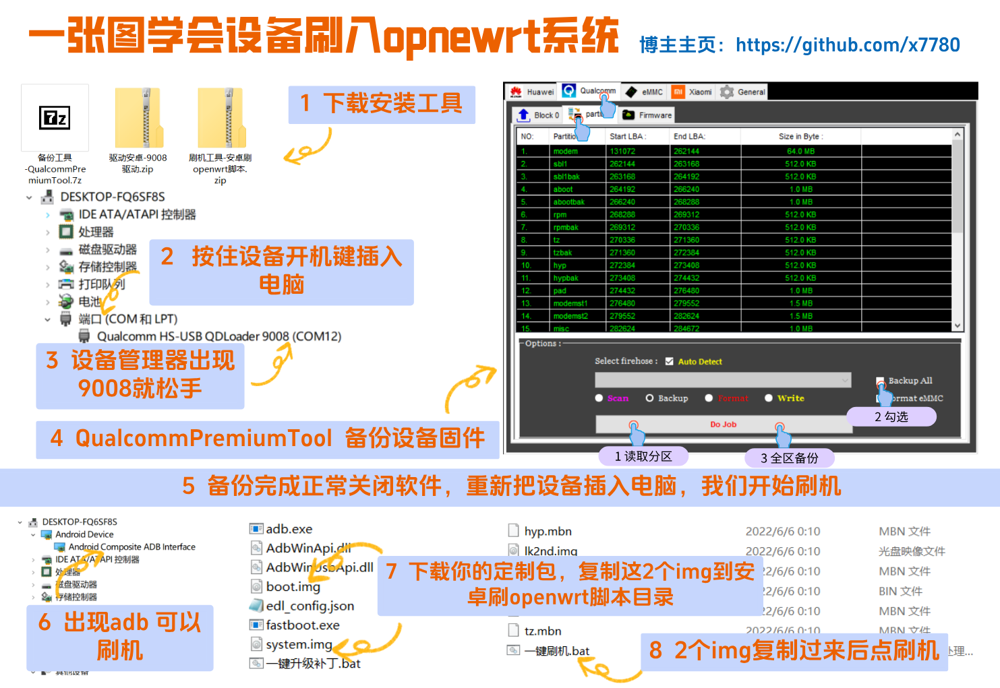
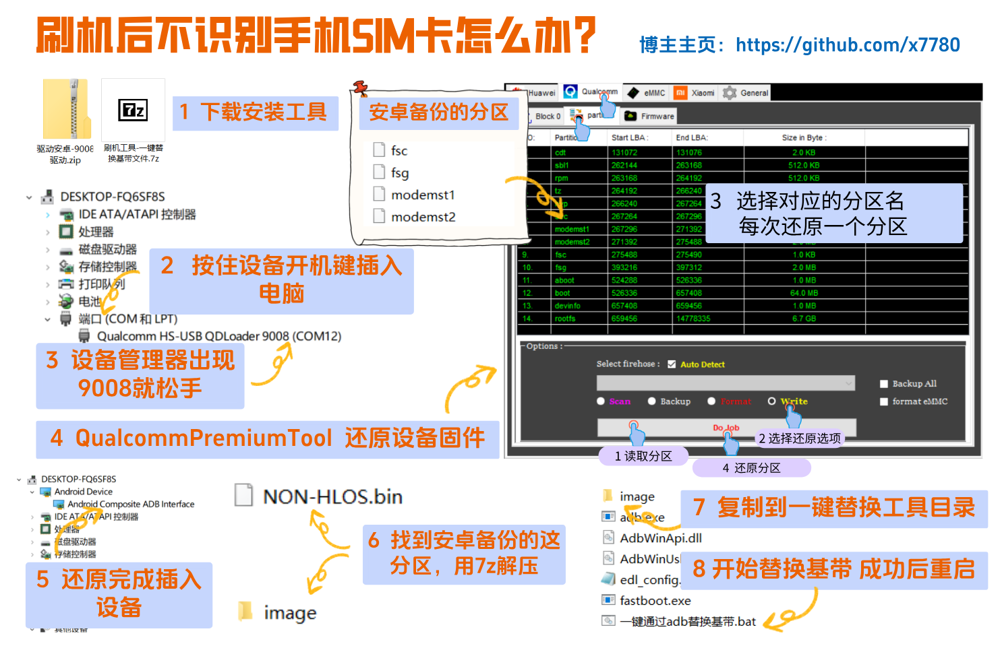

# Qualcomm MSM8916 (Snapdragon 410) Portable Wi-Fi — Online Cloud Build OpenWrt

Tired of finding a decent firmware? Software repos won't install, the version is too old, or someone else's build is bloated with plugins you don't need. Just compile your own OpenWrt flash package — a few simple steps, no local environment needed, no Linux knowledge required, no compilation know-how. Build it, one-click flash it, done.

- Auto-pulls the latest ImmortalWrt source on every build
- Pick exactly the plugins you want; the firmware is entirely up to you
- Base image is heavily optimized — no need to worry about random bugs
- Supports custom packages: plugins, drivers, themes, Python, Perl, libs, and more

---

## Build Steps

1. First, fork this repository to your own account
   

2. Your repo → **Actions** → **Build_imm_Snapdragon_410_series** → **Run workflow** → Select your device model → Enter required plugin packages → Run workflow to start building
   

3. Build takes approx. ⏱️ 1.5–2 hours; more plugins = longer build time
   

4. A green checkmark means a successful build. Your repo → **Releases** → Download the firmware package
   

5. If your device is already running Linux or OpenWrt, follow the steps below to upgrade.
   

   If your device has never been flashed with Linux or OpenWrt and is still on stock Android, follow the tutorial below. **Important: back up your partitions.**
   

   If the SIM card is not detected after flashing, try reinserting it several times. If it still isn't recognized, try the steps below. If you didn't back up the Android partitions, there's not much you can do — ask in the Discussions section and maybe someone kind will share a copy.
   

---

### Recommended Plugin Configurations (copy & paste)

- Essentials: `luci-app-ttyd`
- Proxy / VPN: `luci-app-openclash`
- Ad blocking: `luci-app-adbyby-plus,luci-app-adblock`
- Common combo: `luci-app-ttyd,luci-app-adbyby-plus,luci-app-accesscontrol`

---

## Supported Device Models

| Model   | Notes                                                      |
|---------|------------------------------------------------------------|
| ufi003  | Default — I have this board; best optimized                |
| ufi001c | Supported                                                  |
| ufi001b | Supported                                                  |
| ufi103s | Supported                                                  |
| qrzl903 | Supported                                                  |
| w001    | Supported                                                  |
| uz801   | Supported                                                  |
| mf32    | Supported — [Another repo: Android battery device cracking](https://github.com/x7780/MF32T_MB_V01) |
| mf601   | Supported                                                  |
| wf2     | Supported                                                  |
| jz02v10 | Supported                                                  |
| sp970v11| Supported                                                  |
| sp970v10| Supported                                                  |

---

## Project Directory & File Overview

| Path                   | Description                                                                                   |
|------------------------|-----------------------------------------------------------------------------------------------|
| `config/`              | Build config files for each device model (e.g. `ufi003.config`)                               |
| `files/`               | Files overlaid into the firmware image — system configs. Homepage and remote content live in [files/www](https://github.com/x7780/immortalwrt-Actios/tree/main/files/www) |
| `img/`                 | Tutorial screenshots used in the README                                                       |
| `scripts/`             | Helper scripts executed during the build                                                      |
| `工具与脚本/`          | Flashing tools and helper scripts collection: 9008 driver, baseband, full flashing scripts, etc. |
| `刷机脚本/`            | Integrated into the one-click flash package after a successful build                          |
| `diy-part1.sh`         | Phase 1 custom script — runs after fetching source (add repos, apply patches, etc.)           |
| `diy-part2.sh`         | Phase 2 custom script — runs after default config is generated (tweak config, add files, etc.)|
| `upstream_history.txt` | Historical upstream hash log — use a past hash if the latest won't compile                    |
| `upstream_lock.txt`    | Periodically updated lock of a known-good upstream hash to avoid upstream breakage             |
| `极简的包名.txt`       | Quick-reference list of common plugin package names (backup, not essential)                   |
| `.config`              | Default build config, defines global build options                                            |

---

### Built-in Default Plugins (3 total) — Do NOT re-add these in your build

| # | Plugin                   | Description        | Menu Location      |
|---|--------------------------|--------------------|--------------------|
| 1 | luci-theme-argon         | Argon theme        | Popular theme      |
| 2 | luci-app-package-manager | Package management | System → Software  |
| 3 | luci-app-firewallr       | Firewall           | System → Firewall  |

### Built-in Kernel Driver Modules — Do NOT add duplicates

| #  | Module                          | Description                 | Location       |
|----|---------------------------------|-----------------------------|----------------|
| 4  | kmod-usb-common                 | USB common module           | Kernel modules |
| 5  | kmod-usb-core                   | USB core module             | Kernel modules |
| 6  | kmod-usb-gadget                 | USB Gadget framework        | Kernel modules |
| 7  | kmod-usb-gadget-eth             | USB Gadget Ethernet         | Kernel modules |
| 8  | kmod-usb-gadget-functionfs      | USB Gadget FunctionFS       | Kernel modules |
| 9  | kmod-usb-gadget-mass-storage    | USB Gadget Mass Storage     | Kernel modules |
| 10 | kmod-usb-gadget-ncm             | USB Gadget NCM              | Kernel modules |
| 11 | kmod-usb-gadget-serial          | USB Gadget Serial           | Kernel modules |
| 12 | kmod-usb-lib-composite          | USB Composite device lib    | Kernel modules |
| 13 | kmod-usb-net                    | USB network driver          | Kernel modules |
| 14 | kmod-usb-net-cdc-ether          | USB CDC Ethernet driver     | Kernel modules |
| 15 | kmod-usb-net-cdc-ncm            | USB CDC NCM driver          | Kernel modules |
| 16 | kmod-usb-net-huawei-cdc-ncm     | Huawei CDC NCM driver       | Kernel modules |
| 17 | kmod-usb-net-rndis              | USB RNDIS driver            | Kernel modules |
| 18 | kmod-usb-serial                 | USB serial driver           | Kernel modules |
| 19 | kmod-usb-serial-option          | USB serial Option driver    | Kernel modules |
| 20 | kmod-usb-serial-wwan            | USB serial WWAN driver      | Kernel modules |
| 21 | kmod-usb-wdm                    | USB WDM driver              | Kernel modules |

### Third-party Source Repositories Included

| # | URL                                        | Description                           | Usage                                |
|---|--------------------------------------------|---------------------------------------|--------------------------------------|
| 1 | https://github.com/kenzok8/small-package   | Common OpenWrt package source bundle  | Enter the package name when building |

---

### Recommended Tools

| # | URL                               | Description                                                                         | How to Use                               |
|---|-----------------------------------|-------------------------------------------------------------------------------------|------------------------------------------|
| 1 | https://github.com/3899/SimAdmin  | Excellent SIM card management tool (actively updated by the author)                 | LuCI → Startup → Local Startup Script    |
| 2 | https://picoclaw.io/              | Lightweight proxy — download the Linux ARM64 (arm64) build and extract onto device  | LuCI → Startup → Local Startup Script    |
| 3 | https://pumpkinmc.org/            | Minecraft server — very fast, low memory footprint                                  | Needs to be compiled for OpenWrt         |

---

### Disabled Kernel Debug Info

Reduces firmware size by approx. 50–100 MB:

| Config Option                | Description              | Status         |
|-----------------------------|--------------------------|----------------|
| CONFIG_KERNEL_DEBUG_FS      | Debug filesystem         | Disabled (memory heavy) |
| CONFIG_KERNEL_DEBUG_KERNEL  | Kernel debug logging     | Disabled (memory heavy) |
| CONFIG_KERNEL_DEBUG_INFO    | Full debug symbols       | Disabled (memory heavy) |
| CONFIG_KERNEL_KALLSYMS      | Kernel symbol table      | Disabled (memory heavy) |

---

## Special Thanks

- [xuxin1955/Actions-immortalwrt](https://github.com/xuxin1955/Actions-immortalwrt) — Thanks to the author for the technology
- [lkiuyu/immortalwrt](https://github.com/lkiuyu/immortalwrt) — Thanks to the author for driver and kernel fixes

## Credits

- [Microsoft Azure](https://azure.microsoft.com)
- [GitHub Actions](https://github.com/features/actions)
- [OpenWrt](https://github.com/openwrt/openwrt)
- [ImmortalWrt](https://github.com/xuxin1955/immortalwrt)
- [coolsnowwolf/lede](https://github.com/coolsnowwolf/lede)
- [Mikubill/transfer](https://github.com/Mikubill/transfer)
- [softprops/action-gh-release](https://github.com/softprops/action-gh-release)
- [Mattraks/delete-workflow-runs](https://github.com/Mattraks/delete-workflow-runs)
- [dev-drprasad/delete-older-releases](https://github.com/dev-drprasad/delete-older-releases)
- [peter-evans/repository-dispatch](https://github.com/peter-evans/repository-dispatch)

## License

[MIT](https://github.com/P3TERX/Actions-OpenWrt/blob/main/LICENSE) © [**P3TERX**](https://p3terx.com)
